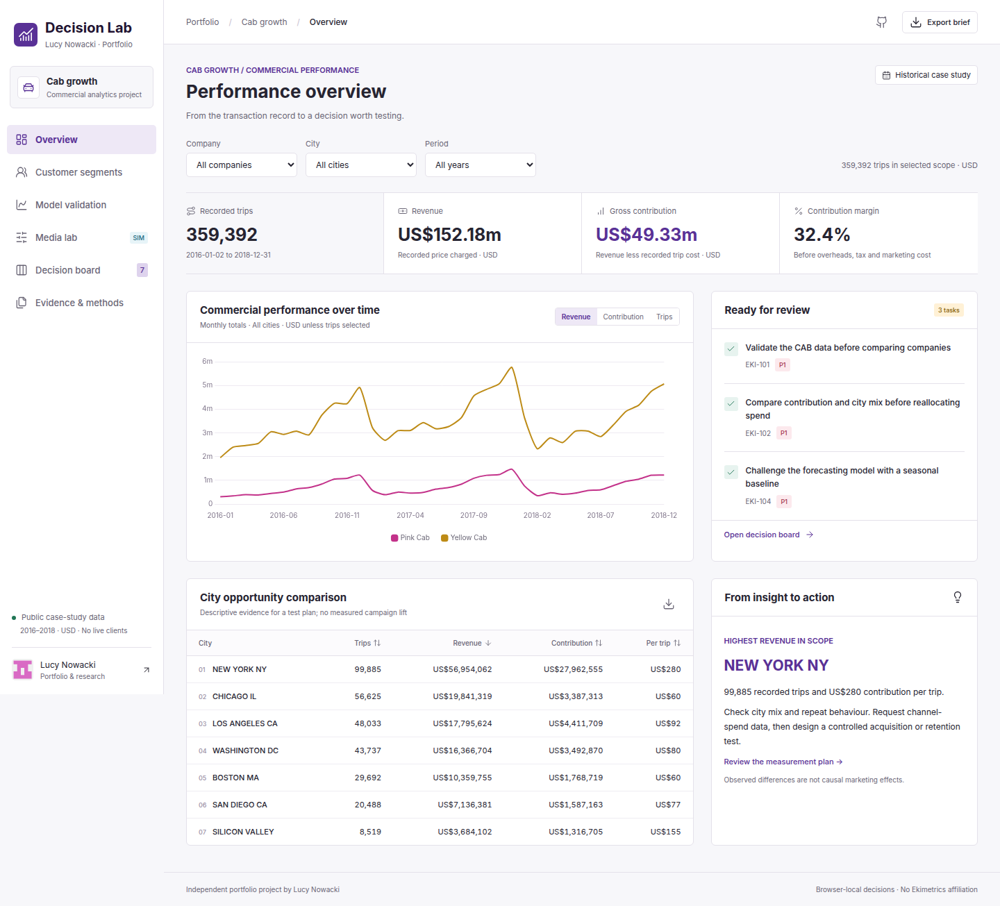
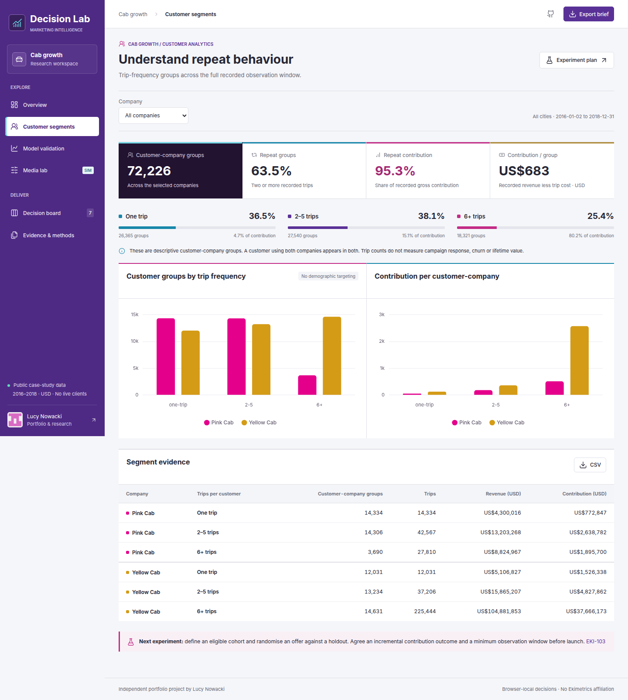
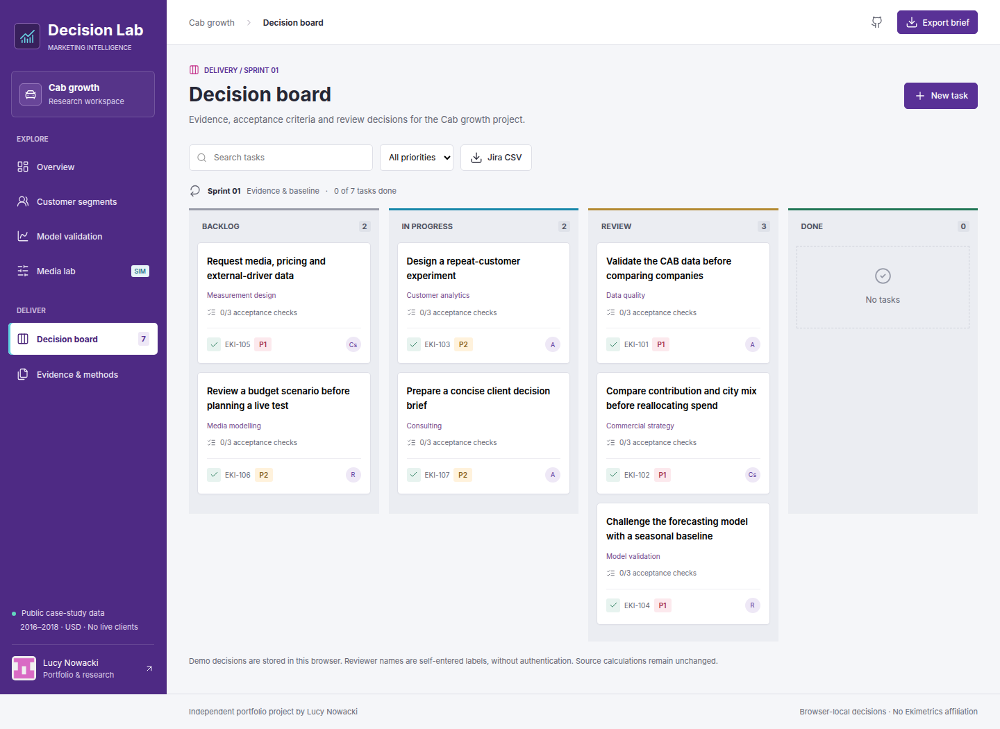
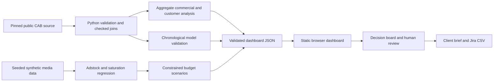

# Marketing Decision Lab

[Open the dashboard](https://lucynowacki.github.io/clearcost/decision-lab/) · [Source branch](https://github.com/LucyNowacki/clearcost/tree/ekimetrics-decision-lab) · [Lucy Nowacki's portfolio](https://lucynowacki.github.io)

An independent portfolio project by **Lucy Nowacki**, connecting commercial data analysis with a reviewable decision workflow. It develops the business question in [CAB_EDA](https://github.com/LucyNowacki/CAB_EDA/blob/main/Cab_2.ipynb) and the source-evidence and human-review approach in [Clearcost](https://lucynowacki.github.io/clearcost/). Built as an application demonstrator for data science and marketing effectiveness, with Ekimetrics' public emphasis on useful business decisions informing the brief. It is not affiliated with Ekimetrics, Atlassian or the companies in the teaching dataset.

## The business problem

A team comparing two cab companies needs more than a revenue chart. It needs to know whether the data is complete, what recorded contribution means, how geography and repeat behaviour affect the comparison, and which evidence is still missing before changing a marketing budget. The dashboard joins those questions to explicit tasks, acceptance criteria and a reviewer decision.

The project also includes a **separate, entirely simulated media experiment**. CAB has no channel-spend data, so its transaction figures cannot support a genuine Marketing Mix Model or an incremental marketing ROI claim. The media lab makes that boundary visible while demonstrating adstock, diminishing returns, holdout evaluation and constrained allocation.

## Explore the app

Start with **Project Purpose**, beside each page heading, for the business question and a suggested route through all six views. The button has a gentle neon pulse, or a static glow when reduced motion is preferred. Its floating guide can be dragged, resized from any edge or corner, maximised, pinned across navigation and made translucent with the opacity slider. Keyboard users can move it with the title bar's arrow keys, resize with Shift + arrow keys, maximise/restore with Enter and close with Escape.

- **Overview:** filter company, city and year; compare trips, recorded revenue and gross contribution; export city comparisons.
- **Customer segments:** compare observed trip-frequency groups, repeat activity and recorded contribution, with a visual composition summary that follows the company filter. These are descriptive customer-company groups across the complete window, not churn or lifetime-value predictions.
- **Model validation:** inspect the later six-month holdout for a Ridge trend/seasonality model alongside a seasonal-naive comparator. The simple baseline performs better for both companies, and that result stays visible.
- **Media lab:** explain Marketing Mix Modelling, adstock and saturation; inspect synthetic channel response and conditional holdout results; adjust a weekly budget and channel shares; compare equal split with a constrained model allocation. An isolated carryover illustration shows how a one-week advertising pulse decays without changing the fitted model.
- **Decision board:** Jira-style Backlog / In progress / Review / Done, owner and priority fields, acceptance criteria, review notes, stale-edit protection, new tasks and a Jira-compatible CSV for manual mapping/import.
- **Evidence & methods:** three application-question drafts with inspectable evidence, source register, join checks and browser review history. Copy an individual draft or download all three for review. Export a Markdown client brief carrying the evidence, uncertainty and current decisions.

Jira itself is not connected. The board applies familiar issue-management ideas to analytical delivery. Browser review labels are not authenticated identities; local history is not an immutable enterprise audit log.

## Application evidence

The Overview connects the application questions to work that can be inspected, not just claims:

| Question | Evidence in the project |
| --- | --- |
| [What is Marketing Mix Modelling?](https://lucynowacki.github.io/clearcost/decision-lab/#evidence/mmm) | Aggregate time-series reasoning; underlying demand versus media response; adstock, saturation and constrained scenarios in a clearly labelled simulation. |
| [When did I solve a problem with data?](https://lucynowacki.github.io/clearcost/decision-lab/#evidence/problem-solving) | Checked joins retaining all 359,392 CAB trips; a chronological holdout where the seasonal baseline beats Ridge; the resulting review workflow. |
| [Why Ekimetrics and MMM?](https://lucynowacki.github.io/clearcost/decision-lab/#evidence/ekimetrics) | A motivation statement connecting quantitative analysis to commercial judgement, grounded in Ekimetrics' public positioning and this independent project. |

These are first-person drafts for Lucy's review, not submitted answers or verified client outcomes. The problem-solving figures are read from the same published data as the dashboard. No client lift, production adoption or experimental calibration is claimed. [Ekimetrics' marketing-effectiveness page](https://www.ekimetrics.com/solutions/marketing-effectiveness) and [careers page](https://www.ekimetrics.com/join-ekimetrics) were checked on 15 October 2026. [Google's Meridian introduction](https://developers.google.com/meridian/docs/basics/meridian-introduction) provides further MMM context; Meridian is not used by this prototype.







## Data and analytical choices

The build validates **359,392 cab trips across 19 observed cities**, retaining every trip through cardinality-checked left joins. A 20-city lookup contains one unused city. The source is public educational case-study data, not independently verified business operating records. Dates span 2 January 2016 to 31 December 2018.

Gross contribution is `Price Charged - Cost of Trip`, in USD. It excludes overheads, tax, financing, capital cost and unobserved marketing cost. It is not net profit. Customers are unique within a company, so a person using both companies appears in both company totals. No individual customer or transaction identifiers are published in the browser export.

DataGlacier inputs are pinned to commit `1fc686d1e8d01d23bd5be9316f77170ac0a7fcd8`. The fetcher records file hashes and checks downloads against the expected source manifest. Raw inputs are ignored by Git. Only aggregate CAB outputs, synthetic media rows and provenance are published. Upstream data and embedded third-party assets retain their own rights; no new licence is asserted over the upstream dataset.

The original CAB notebook is a research starting point. This version corrects date origin handling, replaces potentially lossy inner joins, leaves initial retention unknown and introduces a chronological baseline comparison. It does not endorse or reproduce the original notebook's investment-return calculations or complex forecasting claims.

| CAB company | Ridge WAPE, later 6 months | Seasonal-naive WAPE | Practical interpretation |
| --- | ---: | ---: | --- |
| Pink Cab | 13.65% | 12.35% | More complexity did not improve this holdout |
| Yellow Cab | 13.84% | 12.64% | Keep the baseline in the client discussion |

The **media dataset is simulated in GBP**: 156 weeks, 130 for training and 26 held out. Adstock decay and saturation are fixed to the known generating settings; only regression coefficients are estimated. This deliberately favourable specification is an educational demonstration, not a benchmark of real-world MMM accuracy. The optimiser assumes steady weekly spend after carryover settles. It omits parameter uncertainty, channel interactions, auctions and many real business constraints; extrapolating scenarios are labelled in the interface.

See [methodology](docs/methodology.md) and the generated [data manifest](dist/data/manifest.json) for exact definitions and source hashes.

## Architecture



Python uses pandas, NumPy, scikit-learn and SciPy. The frontend is buildless HTML/CSS/JavaScript with locally bundled Chart.js and Lucide. GitHub Pages serves static files. No server process, API key, tracker, paid service or live LLM is needed in the published app.

## Run in the `lucy` environment

```bash
conda activate lucy
python -m pip install -e '.[test]'
python scripts/fetch_data.py
python scripts/build_data.py
pytest
python -m http.server 8879 --bind 127.0.0.1 --directory dist
```

Open `http://127.0.0.1:8879`. The committed `dist/` already contains the validated export, so browsing the demo does not require downloading raw inputs or running the pipeline. `environment.yml` documents the required conda packages. Do not update or recreate an existing `lucy` environment simply to view the static app.

For browser checks, start that local server, then in another terminal:

```bash
npm ci
npx playwright install chromium
npm run test:browser
```

Alternatively, on a machine with Chrome installed:

```bash
CHROME_PATH=/opt/google/chrome/chrome npm run test:browser
```

The browser suite checks all six views, nonblank charts, data-filter totals, exports, review refusal, persistence, escaped review text, concurrent edits, allocation constraints, Python/browser response agreement, the floating Project Purpose guide, application deep links and answer exports, adstock illustration values, and desktop/mobile layout. See [verification](docs/verification.md) for the observed results and limits. Tests use isolated browser contexts, not personal review history.

## Responsible analysis and AI assistance

AI assistants supported planning, coding, review and documentation. Lucy's role is defining the commercial question and requirements, directing the work, testing behaviour and judging evidence. Published values are calculated by reproducible Python functions; generated prose is not treated as a source of financial truth. A real client deployment would need access controls, data ownership, retention policy, reproducible model governance and shared authenticated review.

Tasks cannot be marked Done through the normal interface until their acceptance criteria, reviewer label and reason are supplied. Raw customer details are excluded from the public dataset. The app deliberately separates historical observations, simulated assumptions and human decisions. It does not execute spending or send client communications.

## Next improvements

Obtain consented real media-spend and outcome data; define confounders and causal assumptions; calibrate against experiments; estimate adstock and saturation with appropriate regularisation and uncertainty; test rolling-origin stability; add a shared authenticated review service and an authorised Jira integration. These are future directions, not completed functionality.

## CV-ready evidence

- Developed an evidence-led marketing analytics demonstrator combining 359,392 public teaching-data trips, validated joins, behavioural segmentation and a decision dashboard.
- Evaluated monthly revenue models on a chronological holdout, reporting a seasonal baseline that outperformed Ridge rather than presenting complexity as an outcome.
- Built a separate simulated media lab illustrating adstock, saturation and constrained budget scenarios, with explicit limits on causality, extrapolation and real-world use.
- Linked analytical findings to Jira-style tasks, acceptance criteria, human-review reasons and exported stakeholder briefs; deployed an interactive browser edition on GitHub Pages.

These bullets describe a portfolio prototype. They do not claim revenue generated, recovered savings, production adoption or a client engagement.
